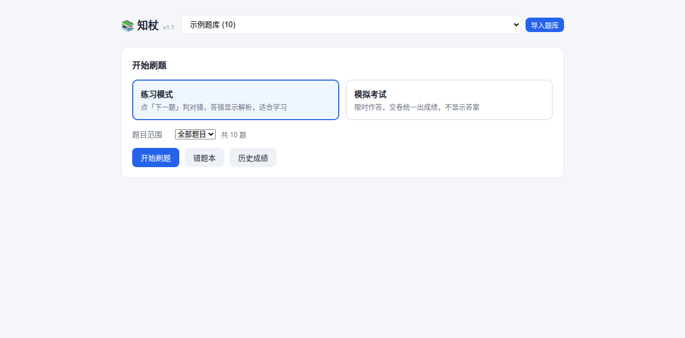
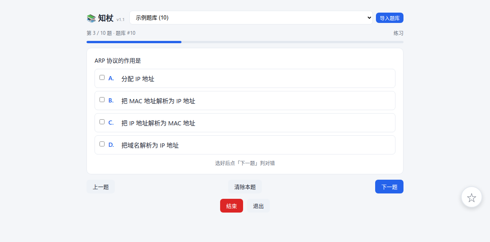
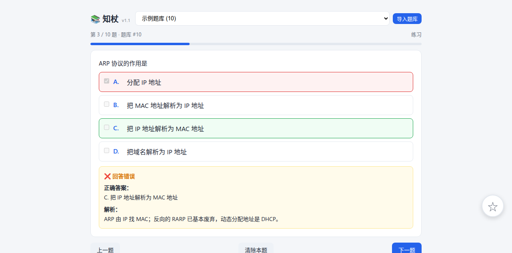
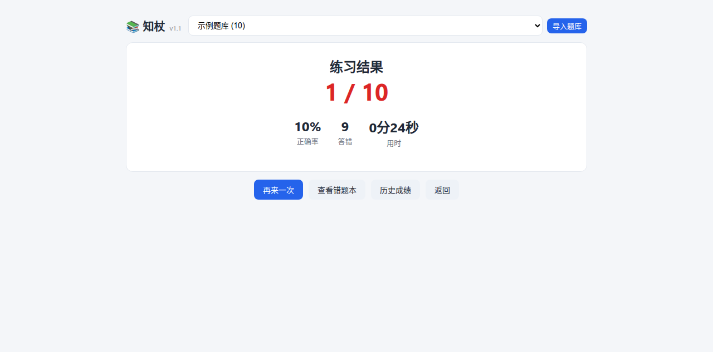

# 知杖 ZhiStaff

本地题库驱动的刷题工具。三种刷题范围、两种模式、错题本与成绩统计，纯前端单文件，离线可用。



## 特点

- **零依赖零构建** —— 一个 `index.html` 打开就能刷，不需要 npm、不需要打包
- **题库可插拔** —— `.bank` 是单个 JSON 文件，配图 base64 内嵌，一个文件就是一个题库；导入即用，不绑定任何科目
- **四种刷题范围** —— 全部题目 / 仅错题本 / 仅收藏 / 随机抽取
- **两种模式** —— 练习（即时判题+解析）和模拟考试（限时、交卷出分、答题卡）
- **断点续答** —— 中途关了页面，下次从原位置继续
- **数据本地存储** —— IndexedDB + localStorage，不上传任何东西
- **三端复用** —— 同一套题库驱动网页、微信小程序、Android

## 快速开始

```bash
git clone https://github.com/CLICGGER-TYPES/zhistaff.git
cd zhistaff
python3 -m http.server 8080
```

浏览器打开 <http://localhost:8080>，点右上角「导入题库」选择任意 `.bank` 文件即可开始。

> 必须用 http 服务器。页面通过 `fetch()` 加载题库，`file://` 协议会被浏览器拦截。

仓库本身**不带题库**，需要自己准备（见[题库](#题库)）。

## 界面

### 答题

单选、多选、填空，选项自动打乱：



### 即时判题

练习模式下答完立刻标出对错选项，给出正确答案和解析：



### 成绩单



### 统计

正确率趋势、对错分布、出错率 TOP 10 排行（Chart.js）：


## 题库

题库是**可插拔的**，任何科目、任何来源的内容，只要符合格式就能刷。

`.bank` 是一个 UTF-8 编码的 JSON 文件，单文件自包含（配图以 base64 内嵌），[完整规范见 docs/BANK_FORMAT.md](docs/BANK_FORMAT.md)。

```jsonc
{
  "name": "示例题库",
  "version": 1,
  "questions": [
    {
      "num": 1,
      "type": "choice",
      "text": "题干文字，选项不写在这里",
      "options": [{"k": "A", "v": "选项一"}, {"k": "B", "v": "选项二"}],
      "answer": ["A"],
      "explain": "答案解析，支持换行",
      "image": "data:image/jpeg;base64,...",
      "meta": {"page": 3, "bad": false}
    }
  ]
}
```

### 两种用法

**方式一：手动导入（推荐）**

打开网页版点「导入题库」，选 `.bank` 文件。导入后存在浏览器本地，下次打开还在。

**方式二：内置目录**

把 `.bank` 放进 `bank/` 目录，并在 `index.html` 里登记：

```js
const BUNDLED_BANKS = ["bank/你的题库.bank"];
```

刷新页面自动加载。

### 从 PDF 生成题库

如果题库原始材料是 PDF，可以用内置提取器转换：

```bash
uv run --with pymupdf python tools/build_bank.py 输入.pdf bank/输出.bank "题库名称"
```

输出一行统计：

```
[题库名称] total=446 choice=423 fill=23 bad=0 with_img=42
```

提取器会切题、合并跨行选项、剥离答案行尾注释、剔除页面水印、内嵌配图。规则细节和已知限制见 [BANK_FORMAT.md](docs/BANK_FORMAT.md)。

配图想加文字描述的话，再用 `tools/transcribe_images.py` 调多模态模型批量生成 `desc` 字段。

### 校验

提交题库前可以检查有没有残缺题：

```bash
python3 -c "
import json,sys
d=json.load(open(sys.argv[1]))
bad=[q for q in d['questions'] if q.get('meta',{}).get('bad')]
print(f\"{d['name']}: 共 {len(d['questions'])} 题, 残缺 {len(bad)}\")
" bank/你的题库.bank
```

## 目录结构

```
.
├── index.html              网页版，单文件，无需构建
├── vendor/chart.umd.js     统计图表
├── bank/                   题库目录（.bank 不入库）
├── tools/
│   ├── build_bank.py       PDF → .bank 提取器
│   ├── transcribe_images.py  配图 OCR 转述
│   └── preflight-check.sh  发布前隐私自检
├── clients/
│   ├── miniprogram/        微信小程序（云开发）
│   └── android/            Android（Capacitor）
└── docs/
    ├── BANK_FORMAT.md      题库格式规范
    ├── USAGE.md            使用教程
    └── screenshots/        截图
```

## 文档

- [使用教程](docs/USAGE.md) —— 网页版 / 小程序 / 安卓各自怎么跑
- [题库格式规范](docs/BANK_FORMAT.md) —— `.bank` 字段定义、PDF 提取规则、校验方法

## 客户端

**微信小程序** —— `clients/miniprogram/`，云开发架构，题库存云存储按 `fileID` 拉取。需要填自己的 APPID 和环境 ID，步骤见[使用教程](docs/USAGE.md)。

**Android** —— `clients/android/`，Capacitor 打包网页版：

```bash
cd clients/android
npm install && npx cap sync android
cd android && ./gradlew assembleDebug
```

## 发布前自检

仓库里带了隐私检查脚本，改完配置要提交前跑一遍：

```bash
bash tools/preflight-check.sh
```

它会检查题库、密钥、内部地址、手机号邮箱有没有被误加进 git。退出码 0 才提交。

## 说明

本仓库只包含**刷题工具本身**，不附带任何题库内容。题库由使用者自行准备和导入，其来源、授权与合规性由使用者自行负责。
